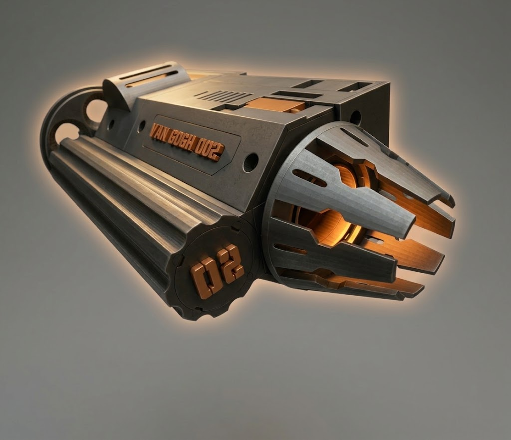
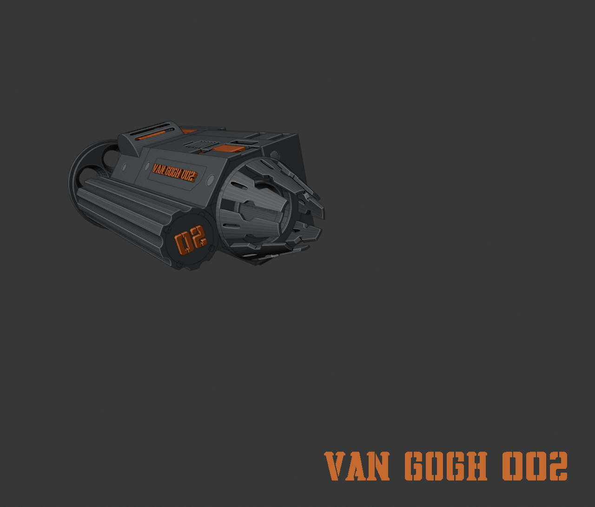
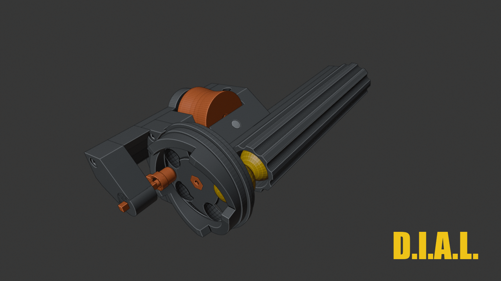
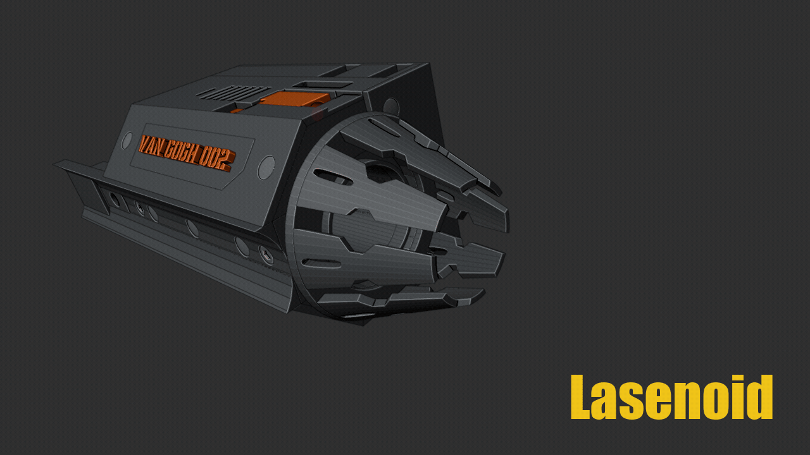
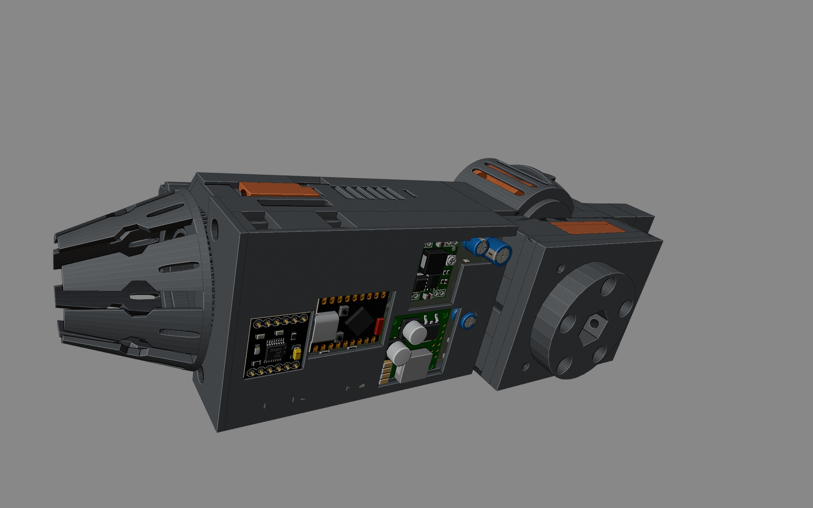
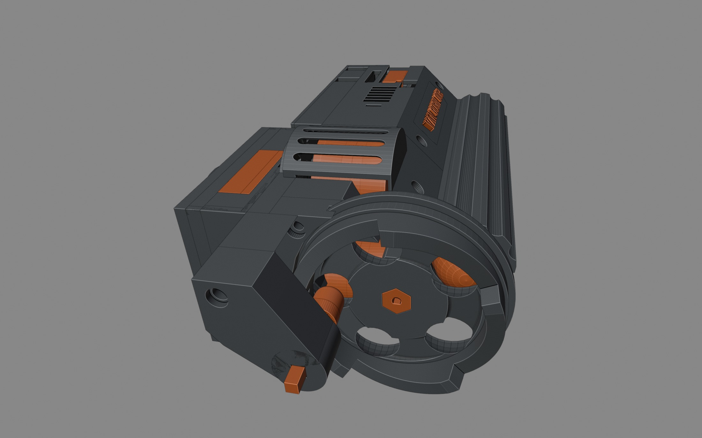
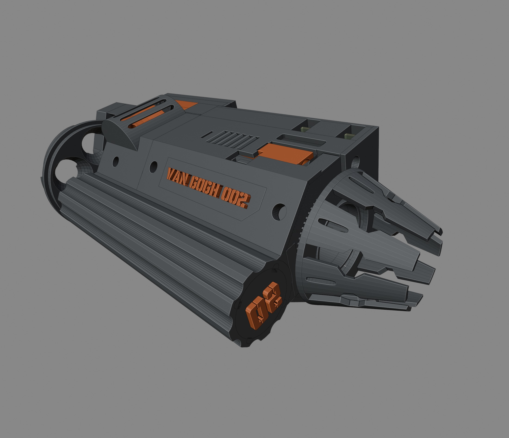

# Van Gogh

Van Gogh is a flywheel barrel that runs as its own machine. Twin wheels take rounds from a spring magazine through a disc indexer (DIAL), one at a time. A single 6S inlet powers the whole unit. On the barrel middle, the barrel control unit (BCU) — the logic board and its printed case — listens for wireless commands on an ESP32-S3 Mini.

It is the right barrel of **Panzer**, a printed dual-barrel turret: two of these barrels on a turntable that pans and tilts them together. Van Gogh is Panzer's first barrel variant, and this repository is the second iteration, **MK II**. You can power it, assemble it, and run it on the bench with nothing else from the turret attached.

## Exploded view

## Interactive model

An interactive model of the barrel — orbit, explode, and inspect each part — is at [van-gogh.themidhunraj.com](https://van-gogh.themidhunraj.com/).

## Features + Core components

### Barrel control unit (BCU)

The barrel control unit (BCU) is the logic board and its printed case, mounted on the barrel middle. An ESP32-S3 Mini takes wireless commands and drives the rest of the barrel: the indexer and cone gearmotors, the solenoid and laser, the status LEDs, and the throttle lines to the flywheel speed controllers. Two onboard regulators step the 6S inlet down to 5 V and 6 V for those loads. Flywheel motor current stays in the power housing, on the speed controllers.

### Disc indexed Ammunition Loader (D.I.A.L)

DIAL is a five-station drum on a gearmotor. A spring magazine drops one round into each pocket as the drum indexes clockwise. A five-lobe axial face cam on the back of the drum turns with it. A spring-loaded plunger follows that cam along the bore: the rise cocks the plunger and compresses the spring, a short dwell holds it fully loaded, and a steep drop lets the spring snap the plunger forward. That stroke pushes the round at the fire station out of its pocket and into the flywheel nip. Indexing and firing are the same rotation. The cam profile sets when the shot leaves. Rinse and repeat.

### Lasenoid

A solenoid and a laser share one linkage. The solenoid stroke runs along the bore and drives an actuation rod. The other end of the rod pushes a carriage up a fixed inclined cam. The laser rides in that carriage, so the stroke raises it and brings the beam onto the bore axis.

### Cone

The muzzle cone spins on a thin-section bearing about the bore. A small gearmotor turns a pinion into a ring gear on the cone. The spin is the ready cue: a turning cone means the barrel is live, and the motion itself shows the drive is running.

### Flywheels

Two brushless motors each carry a wheel and spin in opposite directions, both contact faces moving toward the muzzle at the nip. A round pushed into that gap is gripped on both sides and accelerated down the bore. The wheels stay at speed between shots, so each plunged round meets an already-spinning pair.

### LED stick

An addressable WS2812B stick sits in the barrel middle and takes a single data line from the BCU. Each pixel can be set on its own, so the stick shows live status along its length: flywheel speed, barrel readiness, and faults.

## Photos

### Gallery

## Interface

Raw **6S** pack power (about 19–25.2 V, 22.2 V nominal) enters through an **XT90 male** in the power housing. Use a matching lead on **10 AWG** up to that connector.

The **PH ceiling / PYE connector** plate closes the power housing. Its hex socket is how the barrel mounts on Panzer when you use the full turret.

## Status

This repository documents one right barrel: the mechanical design, assembly guide, bill of materials, logic-board pin reference, and KiCad project. Printable meshes will be added in [models/](models/). The logic PCB was ordered as JLCPCB **Y14-2705430A** (2-layer, 56 × 92.6 mm, 1.6 mm, 1 oz, black). Sources and Gerbers: [kicad/](kicad/).

## Documentation

| File                                     | Contents                                                                                         |
| ---------------------------------------- | ------------------------------------------------------------------------------------------------ |
| [bom.md](bom.md)                         | Everything for one barrel — printed parts, fasteners, hardware, connectors, and board components |
| [cost.md](cost.md)                       | Bought-part cost for one barrel. Printed parts excluded                                          |
| [catalog.md](catalog.md)                 | Visual index of printed parts                                                                    |
| [assembly.md](assembly.md)               | Step-by-step build                                                                               |
| [power.md](power.md)                     | Inlet, XT90 split, regulators, Molex pinout, power budget                                        |
| [board.md](board.md)                     | Logic board — every reference and pin                                                            |
| [kicad/](kicad/)                         | KiCad project and `gerber.zip` for fabrication                                                   |
| [models/](models/)                       | 3D model files for the printed parts                                                             |
| [firmware/README.md](firmware/README.md) | Barrel control firmware for the ESP32-S3 Mini                                                    |
| [LICENSE](LICENSE)                       | Creative Commons Attribution-NonCommercial 4.0                                                   |

## Safety

This barrel takes a 6S lithium pack (about 19–25.2 V) and spins two brushless flywheels. A short on the XT90 or the speed-controller leads can dump the pack. The wheels store energy while they are at speed and will grab anything that enters the nip. A visible laser is aimed along the bore; do not look into the beam or aim it at anyone. Power the barrel only while it is held or clamped, and keep a way to disconnect the pack.